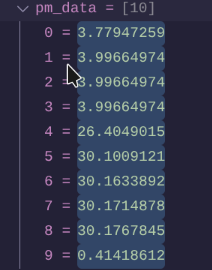
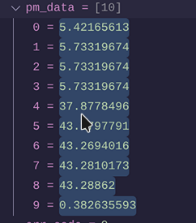
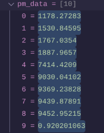

# STM32 Air Quality Monitor

An embedded air quality monitor built around an **STM32 NUCLEO-F446RE** development board. The goal is a standalone device that measures airborne particulate matter (PM) and carbon dioxide (CO₂), displays the readings on an e-ink screen, and fits into an enclosure.

**Status:** SPS30 reliably working and validating checksum after receiving measurements. Tested with a candle and observed expected increases.

## Hardware

| Component | Role | Interface | Status |
| --- | --- | --- | --- |
| STM32 NUCLEO-F446RE | Microcontroller development board | — | Firmware builds and runs |
| Sensirion SPS30 | PM1.0, PM2.5, PM4, and PM10 measurements | UART | Working — measurements decoded and checksum validated |
| Sensirion SCD41 | CO₂ measurements | I²C | Planned |
| Waveshare 2.13-inch e-Paper HAT V4 (black/white) | Local display | SPI | Planned |
| Perfboard and enclosure | Permanent assembly | — | Planned |

## Software and tools

- **Language:** C
- **Firmware:** STM32 HAL, configured with STM32CubeMX
- **Communication:** UART for the SPS30; I²C and SPI planned for the other components

## Current progress

- [x] Set up the STM32 development environment and build the firmware.
- [x] Connect the SPS30 to the Nucleo and confirm that its fan operates.
- [x] Debug UART transmissions and observe an initial receive response.
- [x] Implement frame reception, byte unstuffing, and checksum validation.
- [x] Decode the SPS30 measurements into floating-point values.
- [ ] Connect the e-ink display and show sensor readings.
- [ ] Format readings for an organized display.
- [ ] Integrate the SCD41 CO₂ sensor.
- [ ] Move the wiring to perfboard and mount the system in an enclosure.

## SPS30 Testing

Tested the SPS30 under three conditions: ambient air, near a lit candle, and after extinguishing the candle. The extinguished candle produced a pronounced spike in particulate readings, with PM2.5 reaching approximately 1,530 µg/m³. This is a functional test of sensor responsiveness, not a calibration test.

| Ambient air | Lit candle | Extinguished candle |
|:---:|:---:|:---:|
|  |  |  |

### Measurement Data

The SPS30 returns 10 floating-point measurements, stored in the `pm_data` array.

| Index | Measurement | Unit |
|---|---|---|
| 0 | PM1.0 mass concentration | µg/m³ |
| 1 | PM2.5 mass concentration | µg/m³ |
| 2 | PM4.0 mass concentration | µg/m³ |
| 3 | PM10 mass concentration | µg/m³ |
| 4 | NC0.5 particle concentration | particles/cm³ |
| 5 | NC1.0 particle concentration | particles/cm³ |
| 6 | NC2.5 particle concentration | particles/cm³ |
| 7 | NC4.0 particle concentration | particles/cm³ |
| 8 | NC10 particle concentration | particles/cm³ |
| 9 | Typical particle size | µm |

## SPS30 UART prototype wiring

Current test configuration using **USART1** on the NUCLEO-F446RE:

| SPS30 signal | Nucleo connection |
| --- | --- |
| VDD | 5 V |
| GND | GND |
| RX (sensor input) | D8 / PA9 / USART1_TX |
| TX (sensor output) | D2 / PA10 / USART1_RX |
| SEL | Not connected (selects UART mode) |

The SPS30 uses Sensirion's SHDLC protocol over UART. The receive logic must identify complete frames and validate them before treating the payload as sensor data.

## Operation

**Implemented**: The application starts SPS30 measurements, requests data over UART, validates and decodes the response, and can stop measurements. The driver exposes the measurements to the calling code.

**Planned**: Update the e-ink display with current PM and CO₂ measurements, improve recovery from communication failures, and assemble the device in an enclosure.

## Build and development

The project is currently built and debugged using a CMake-based STM32 toolchain. Build, flash, and hardware setup instructions will be documented once the prototype configuration is stable.

## Development notes

See [the development log](docs/development-log.md) for ongoing hardware bring-up, debugging observations, and design decisions.

## Reference

- [Sensirion SPS30 product documentation](https://sensirion.com/sps30)
